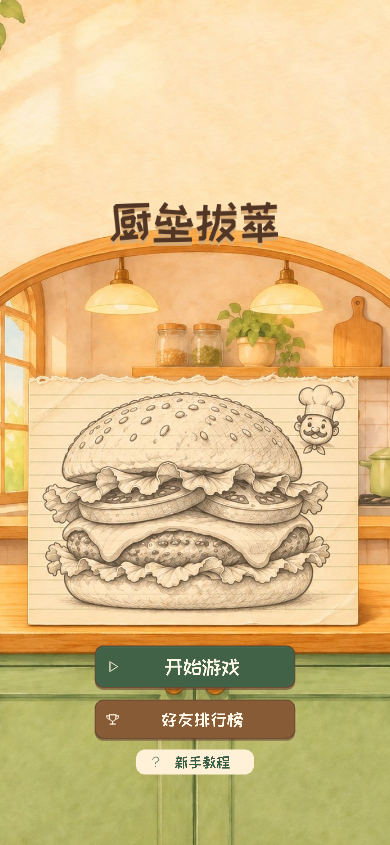
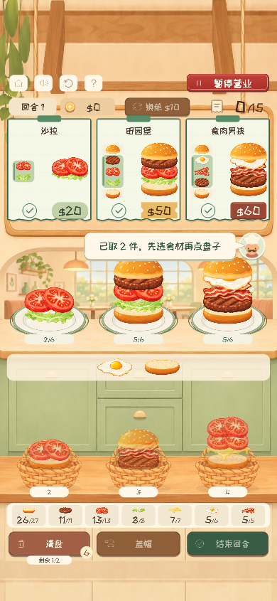
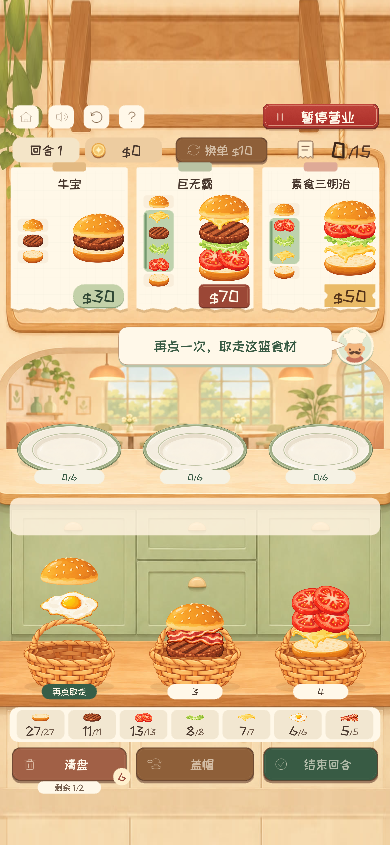
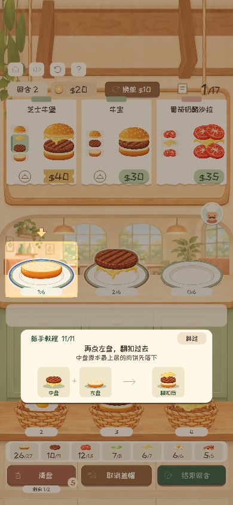
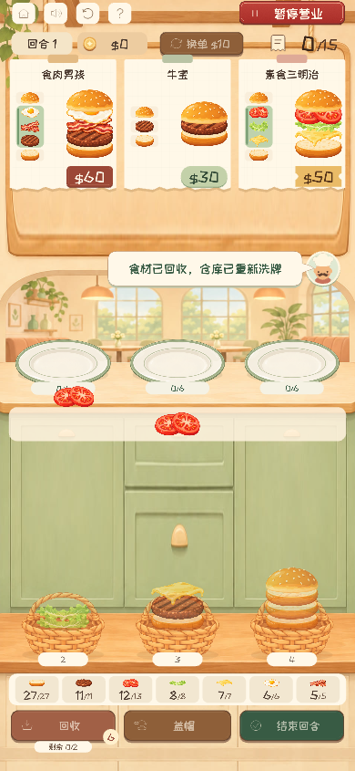
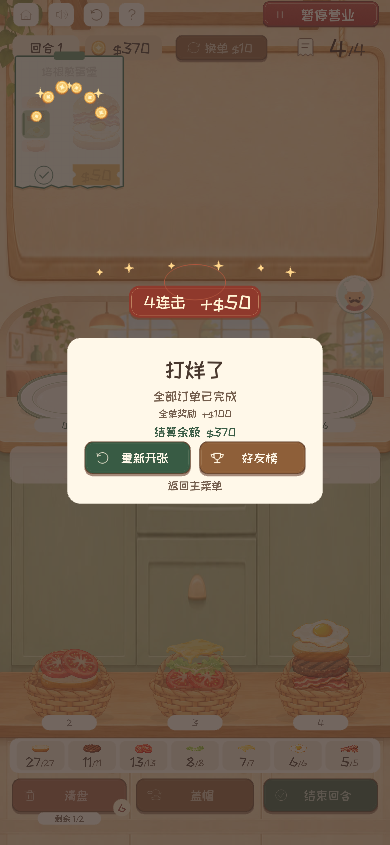

# 厨垒拔萃 · Pile Up

一款用 Cocos Creator 和 TypeScript 开发的竖屏料理策略游戏。每回合只能带走一篮食材。你要在三个盘子之间安排备料、翻盘和出餐，在有限的库存里尽量完成更多订单。

## 游戏预览

以下截图来自开发预览，展示主菜单、备餐和整篮取料。

| 主菜单 | 备餐与出餐 | 食材篮预览 |
| :---: | :---: | :---: |
|  |  |  |

## 怎么玩

1. **选一篮。** 点篮子一次预览，再点一次取走整篮。左、中、右篮分别按 2、3、4 件补货。
2. **备好菜。** 把食材分配到三个盘子，每盘最多 6 层。用「盖帽」把一整盘翻扣到另一盘，原来最上面的食材先落下。
3. **按单出餐。** 整盘符合食谱就能交付。订单上同一条绿带里的食材可以互换顺序。同回合第 2、3、4 次出餐分别额外赚取 `$20`、`$30`、`$50`。
4. **管理库存。** 用完手上的食材即可结束回合。花余额换一张订单，或消耗一次回收机会，把整盘食材放回仓库并重新洗牌。

| 盖帽教学 | 盘子回收 | 连击与结算 |
| :---: | :---: | :---: |
|  |  |  |

## 当前进度

- 已实现完整对局。每局从 77 件食材开局，默认 15 单，同屏最多 3 单。订单池包含 12 道菜，全单完成奖励 `$100`。
- 已加入低相似度换单、食材回收与洗牌，以及取料、落盘、回收和换单动画。
- 支持可重玩的新手教程、静音、快速重开和暂停营业结算。微信好友榜按正式对局的历史最高结算余额排名，实机联测待完成。
- 当前提交通过 167 项玩法规则检查与 4 项好友榜模拟测试。

## 本地运行

1. 用 **Cocos Creator 3.8.8** 打开仓库根目录。
2. 等待资源导入，打开 `assets/scenes/game.scene`，点击编辑器顶部的预览按钮。
3. 用浏览器的手机视口体验竖屏布局。微信好友榜需要在微信小游戏环境里运行。

在仓库根目录用 Node.js 运行现有测试。

```sh
npx --yes tsx tests/rules.test.ts
node --test tests/friend-rank.test.cjs
```

### 微信小游戏构建

1. 复制 `build-config-wechat.example.json` 为 `build-config-wechat-release.json`，替换两个 `YOUR_WECHAT_APP_ID`，保留竖屏和场景设置。
2. 在 Cocos Creator 的构建发布面板导入该配置，构建微信小游戏发布包，输出至 `build/wechatgame-release`。
3. 在仓库根目录运行 `node tools/package-wechat-release.cjs`，配置资源分包与好友榜开放数据域。
4. 用微信开发者工具导入 `build/wechatgame-release`，检查登录授权、好友榜和真机安全区。

## 工程导航

| 路径 | 内容 |
| --- | --- |
| [`assets/scenes/`](assets/scenes/) | Cocos 游戏场景 |
| [`assets/scripts/core/`](assets/scripts/core/) | 对局状态、订单池、食谱和库存规则 |
| [`assets/scripts/ui/`](assets/scripts/ui/) | 界面、引导、音效和动画 |
| [`assets/resources/`](assets/resources/) | 运行所需的美术、音频和字体 |
| [`build-templates/wechatgame/`](build-templates/wechatgame/) | 微信构建模板与好友榜开放数据域 |
| [`tests/`](tests/) | 玩法规则与好友榜模拟测试 |
| [`tools/`](tools/) | 微信发布包处理和位图字体生成工具 |

## 素材署名

- 背景音乐为 OatCog 的《Coffee House Bump》，使用 CC0 授权。[原始发布页](https://opengameart.org/content/coffee-house-bump)
- 游戏内中文字形源自站酷快乐体，使用 SIL Open Font License 1.1。[随仓库附带的许可](assets/resources/fonts/OFL-ZCOOL-KuaiLe.txt)
